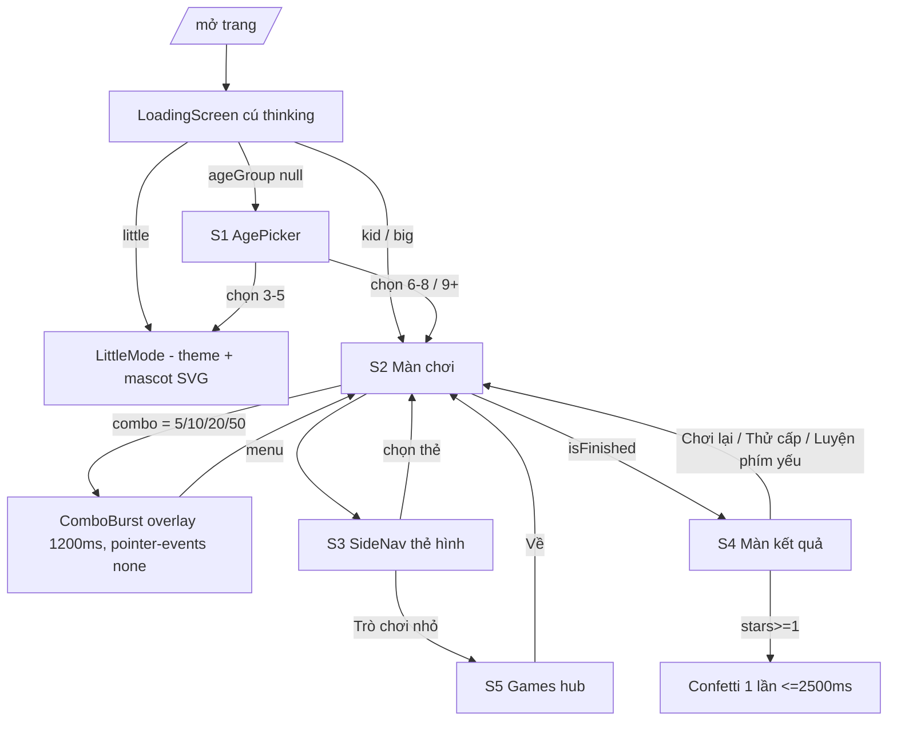

# KR · Thiết kế lại giao diện thân thiện trẻ em — Design

Trạng thái: approved
Nguồn: 01-requirements.md (KR-01…KR-22, E1…E15, Q1…Q8), hệ thiết kế từ skill ui-ux-pro-max (Claymorphism, palette "learning blue + play yellow + fun pink", Baloo 2, motion stagger back-out).

## Luồng người dùng
1. Mở `/` → `LoadingScreen` (cú SVG `thinking`, nhún nhẹ) trong lúc hydrate store (KR-04).
2. `ageGroup === null` → **S1 AgePicker**: cảnh đồng cỏ, cú `wave`, 3 thẻ tuổi có minh hoạ, xuất hiện stagger (KR-06, KR-07, KR-12).
3. Chọn thẻ → `setAgeGroup` → `little`: LittleMode (chỉ đổi theme + mascot SVG, KR-13) / `kid`,`big`: **S2 Màn chơi**.
4. S2: gõ phím → phản hồi ký tự (giữ `charPop`/`shake`), combo pill `x{n}`; chạm mốc 5/10/20/50 → **C-ComboBurst** đè trên vùng chữ ≤1200ms, không chặn input (KR-09, KR-15).
5. Bấm menu → **S3 SideNav**: chọn chế độ/bài/cấp bằng thẻ hình → ván mới (KR-11).
6. Ván kết thúc → **S4 Màn kết quả**: cú theo kết quả, sao SVG bật lần lượt, confetti một lần (KR-10) → Chơi lại / Thử cấp / Luyện phím yếu → quay lại S2.
7. SideNav → "Trò chơi nhỏ" → **S5 Games hub** `/games` (KR-06, KR-07).
8. Các trang còn lại: chỉ đổi theme (**S6**, KR-13).



## Hệ thiết kế (design tokens)

### Chiến lược token
- Thêm lớp token mới `--kr-*` trong `apps/web/src/styles/globals.css` (hoặc file mới đề xuất `apps/web/src/styles/tokens.css` import đầu tiên) cho cả 3 theme.
- **Ánh xạ token cũ sang token mới** (`--ink`, `--ink-dim`, `--surface`, `--surface-2`, `--surface-edge`, `--line`, `--berry`, `--sun`, `--coral`, `--leaf`, `--overlay`, `--scene`…) để mọi màn chỉ-đổi-theme (KR-13) tự nhận bảng màu mới mà không phải sửa từng file. Ví dụ `--ink: var(--kr-fg)`, `--surface: var(--kr-card)`, `--berry: var(--kr-primary)`.
- Giữ nguyên 3 giá trị theme, `THEME_BOOT` và key `typingAdventure_settings` (KR-02, KR-21). Bảng màu mới **thay giá trị theme `light`** (theo giả định Q2).

### Màu theo theme
| Token | light (mặc định) | colorful | dark | Dùng cho |
|---|---|---|---|---|
| `--kr-bg` | `#EFF6FF` | `#FDF2F8` | `#0F172A` | nền trang (dưới cảnh) |
| `--kr-card` | `#FFFFFF` | `#FFFFFF` | `#1E293B` | thẻ, modal, SideNav, bàn phím |
| `--kr-card-soft` | `#F1F5FD` | `#FCE7F3` | `#273449` | ô số liệu, khối phụ |
| `--kr-fg` | `#0F172A` | `#0F172A` | `#F1F5F9` | chữ chính |
| `--kr-fg-muted` | `#475569` | `#475569` | `#CBD5E1` | chữ phụ |
| `--kr-primary` | `#2563EB` | `#7C3AED` | `#60A5FA` | nút chính, ring, thẻ đang chọn |
| `--kr-primary-deep` | `#1D4ED8` | `#5B21B6` | `#3B82F6` | viền/bóng nút chính |
| `--kr-on-primary` | `#FFFFFF` | `#FFFFFF` | `#0F172A` | chữ trên nút chính |
| `--kr-primary-soft` | `#DBEAFE` | `#EDE9FE` | `#1E3A8A` | nền thẻ đang chọn |
| `--kr-play` | `#F59E0B` | `#F59E0B` | `#FBBF24` | nút "chơi"/nhấn mạnh, sao, combo |
| `--kr-play-deep` | `#B45309` | `#B45309` | `#D97706` | viền/bóng nút vàng, viền sao |
| `--kr-on-play` | `#0F172A` | `#0F172A` | `#0F172A` | chữ trên vàng (không bao giờ trắng) |
| `--kr-fun` | `#EC4899` | `#EC4899` | `#F472B6` | điểm nhấn vui, nhãn kỷ lục |
| `--kr-fun-deep` | `#BE185D` | `#BE185D` | `#DB2777` | viền/bóng hồng |
| `--kr-on-fun` | `#000000` | `#000000` | `#0F172A` | chữ trên hồng |
| `--kr-success` | `#15803D` | `#15803D` | `#4ADE80` | ký tự đúng, phím đúng |
| `--kr-danger` | `#DC2626` | `#DC2626` | `#F87171` | ký tự/phím sai, lỗi |
| `--kr-on-danger` | `#FFFFFF` | `#FFFFFF` | `#0F172A` | chữ trên đỏ |
| `--kr-edge` | `#BFD3F6` | `#F5C6EC` | `#334155` | viền dày thẻ/chip trung tính |
| `--kr-drop` | `#C7D7F5` | `#F0BFE3` | `#0B1222` | bóng "đế" đặc dưới thẻ |
| `--kr-glow` | `rgba(37,99,235,.14)` | `rgba(124,58,237,.16)` | `rgba(0,0,0,.45)` | bóng mềm ngoài |
| `--kr-ring` | `#2563EB` | `#7C3AED` | `#93C5FD` | vòng focus |
| `--kr-overlay` | `rgba(15,23,42,.45)` | `rgba(59,7,100,.40)` | `rgba(2,6,23,.70)` | nền mờ modal/SideNav |

Màu thẻ tuổi / badge (chỉ nền, chữ luôn `--kr-fg`): vàng nhạt `#FEF3C7`, xanh nhạt `#DBEAFE`, hồng nhạt `#FCE7F3`; dark: `#3B2F12`, `#1E3A8A`, `#4A1D3A` (chữ `#F1F5F9`).

### Hình khối clay
| Token | Giá trị | Ghi chú |
|---|---|---|
| `--kr-border-w` | `3px` (thẻ, chip, nút) / `4px` (modal, thẻ đang chọn) | KR-01 |
| `--radius-sm` | `12px` | phím ảo, ô nhỏ (đổi từ 10px) |
| `--radius-md` | `16px` | chip, ô số liệu, select (đổi từ 18px) |
| `--radius-lg` | `24px` | thẻ, SideNav, vùng chữ (đổi từ 26px) |
| `--radius-xl` | `32px` | modal kết quả |
| `--radius-pill` | `999px` | nút pill, combo pill |
| `--kr-shadow-sm` | `0 4px 0 var(--kr-drop), inset 0 -3px 0 rgba(15,23,42,.08), inset 0 2px 0 rgba(255,255,255,.55)` | chip, phím ảo |
| `--kr-shadow-md` | `0 6px 0 var(--kr-drop), 0 12px 24px var(--kr-glow), inset 0 -4px 0 rgba(15,23,42,.08), inset 0 3px 0 rgba(255,255,255,.6)` | thẻ, nút |
| `--kr-shadow-lg` | `0 8px 0 var(--kr-drop), 0 18px 36px var(--kr-glow), inset 0 -5px 0 rgba(15,23,42,.08), inset 0 4px 0 rgba(255,255,255,.6)` | modal, vùng chữ |
| `--kr-shadow-pressed` | `0 1px 0 var(--kr-drop), inset 0 3px 6px rgba(15,23,42,.16)` | trạng thái `:active` |
| Dark | Thay `rgba(255,255,255,.6)` bằng `rgba(255,255,255,.08)` trong inset trên | tránh viền sáng chói |

Nút có màu (`primary`, `play`, `fun`, `danger`, `go`) dùng `border: 3px solid var(--kr-*-deep)` và đế `0 5px 0 var(--kr-*-deep)` thay cho `--kr-drop`.

### Typography (trả lời Q1)
- **Quyết định: Baloo 2 cho cả tiêu đề và thân bài.** Lý do: đã nạp qua `next/font/google` (tự host tại build, cùng origin, KR-03/KR-16), có subset `vietnamese` nên mọi dấu render cùng một font, không tốn thêm byte font, dáng tròn hợp trẻ em. Comic Neue bị loại vì không có `vietnamese`. Phương án dự phòng nếu cần chữ thân bài "mảnh" hơn: Nunito (có `vietnamese`), chỉ thêm 1 weight 500.
- Thêm weight `400` vào `Baloo_2({ weight: [...] })` trong `app/layout.tsx`.
- Token: `--font-heading: var(--font-kid), system-ui, sans-serif`; `--font-body: var(--font-kid), system-ui, sans-serif`; `--font-ui` trỏ về `--font-body` (bỏ fallback Nunito/Comic Sans để không lẫn font khi dấu thiếu).
- Thang chữ (rem, gốc 16px): tiêu đề màn 2.25 / 800; tiêu đề thẻ 1.35 / 700; thân 1.125 / 500 (tối thiểu 1rem cho chữ phụ); nhãn số liệu 0.95 / 600; ký tự cần gõ 2.4 desktop, 1.9 mobile / 600; combo burst 3.5 / 800; sao kết quả 56px.
- `line-height` ≥ 1.5 cho chữ có dấu; `.char` có `padding-top: .12em` và `transform-origin: 50% 100%` để `charPop` không cắt dấu (E14).

### Motion tokens
| Token | Giá trị |
|---|---|
| `--kr-ease-back` | `cubic-bezier(0.34, 1.4, 0.64, 1)` (xấp xỉ back.out(1.4)) |
| `--kr-ease-out` | `cubic-bezier(0.16, 1, 0.3, 1)` (giữ `--ease-out`) |
| `--kr-dur-press` | `120ms` |
| `--kr-dur-hover` | `180ms` |
| `--kr-dur-enter` | `400ms` |
| `--kr-stagger` | `80ms` |
| `--kr-dur-combo` | `1200ms` |
| `--kr-dur-star` | `450ms` |
| `--kr-star-gap` | `220ms` |
| `--kr-dur-confetti` | `2200ms` (ngân sách tối đa 2500ms) |

Quy tắc chung: chỉ animate `transform`/`opacity` (riêng nhấn nút cho phép đổi `box-shadow` tức thì). Mọi keyframe "vào màn" dùng `animation-fill-mode: both` và **khung cuối = trạng thái nghỉ** (opacity 1, transform none), để khi reduced-motion rút thời lượng về ~0 thì nội dung hiện đúng vị trí.

## Mascot "Cú Bin" (trả lời Q6: giữ cú, tự vẽ SVG trong repo)

### Hình
- `viewBox="0 0 120 120"`, vẽ inline trong component (không tải file), mục tiêu ≤ 6 KB cho mọi trạng thái cộng lại (phần thân dùng chung, chỉ đổi nhóm mắt/cánh/mỏ).
- Thân hình trứng bo tròn `#60A5FA`, bụng kem `#FEF3C7` có 3 vảy chữ V `#FDE68A`, viền ngoài `#1E3A8A` 3px (đúng phong cách clay viền dày), 2 chỏm tai tròn, 2 mắt tròng trắng r=16 với con ngươi `#0F172A` r=7 và chấm sáng trắng r=2.5, mỏ tam giác bo `#F59E0B` viền `#B45309`, má hồng `#F9A8D4` opacity .8, cánh `#3B82F6`, chân 2 móng `#F59E0B`. Bóng đổ elip `rgba(15,23,42,.15)` dưới chân.
- Dark theme: giữ màu cú (tương phản tốt với nền `#0F172A`), viền đổi `#0F172A` → `#BFDBFE` để thấy rõ đường bao.

### Trạng thái (`mood`)
| mood | Mắt | Cánh | Mỏ/miệng | Phụ kiện | Animation (one-shot trừ khi ghi "loop") | Dùng ở |
|---|---|---|---|---|---|---|
| `idle` | tròn mở, chớp mắt | khép 2 bên | đóng | — | `owl-breathe` loop 3s scale 1→1.03; `owl-blink` loop 4.5s | TopBar, SideNav, Little |
| `wave` | cười ^ ^ | cánh phải giơ, vẫy | mở cười | — | `owl-wave` 2 lần × 600ms, rồi về `idle` | AgePicker, LittleHome |
| `happy` | cười ^ ^ | 2 cánh mở nhẹ | mở cười | 2 tia lấp lánh | `owl-hop` 500ms (translateY -10px, back-out) | combo milestone, kết quả thắng |
| `cheer` | sao nhỏ trong mắt | 2 cánh giơ cao | mở to | 4 lấp lánh bật ra | `owl-hop` × 2 (900ms) + `sparkle-pop` | kết quả 3 sao |
| `encourage` | mở, lông mày cong lên | cánh phải giơ "cố lên" | cười nhẹ | trái tim nhỏ | `owl-nod` 600ms (rotate ±4deg) | kết quả thua/0 sao, hết mạng |
| `sad` | lông mày trễ xuống, mắt nửa khép | cánh buông | mỏ hơi trễ | — | `owl-droop` 500ms (translateY 4px) | dự phòng (KR-04 tối thiểu); kết quả dùng `encourage` để không làm trẻ buồn |
| `thinking` | nhìn lên-phải | cánh trái chạm cằm | đóng | 3 chấm "…" | `owl-tilt` 600ms (rotate -6deg) | LoadingScreen, kết quả hết giờ khi 0 sao |
| `sleep` | 2 đường cong khép | khép | đóng | 2 chữ "z" SVG | `zzz-float` loop 2.4s | Little (thay 💤) |

- Props đề xuất: `mood`, `size` (`sm` 40px, `md` 96px, `lg` 140px), `still?: boolean` (tắt mọi loop, dùng khi `isPlaying`). Luôn `aria-hidden="true"`, `focusable="false"`.
- Loop (`breathe`, `blink`, `zzz`) bị **tạm dừng** khi đang chơi (KR-16, Q5) và tắt hẳn khi reduced-motion.

## Minh hoạ và cảnh trang trí

### Tài sản (đề xuất `apps/web/public/illustrations/`, SVG tối ưu, cùng origin)
| File | Nội dung | Cỡ hiển thị | Ngân sách |
|---|---|---|---|
| `scene-day-top.svg` | 3 đám mây clay, mặt trời cười, 2 chim nhỏ | trải rộng 2 góc trên | ≤ 18 KB |
| `scene-day-bottom.svg` | 2 lớp đồi xanh `#86EFAC`/`#4ADE80`, hoa, khối chữ A B C | dải đáy cao 160px | ≤ 18 KB |
| `scene-candy-top.svg` / `-bottom.svg` (colorful) | mây hồng, cầu vồng; đồi tím/hồng, kẹo | như trên | ≤ 18 KB mỗi file |
| `scene-night-top.svg` / `-bottom.svg` (dark) | trăng khuyết, sao (tĩnh); đồi xanh đậm, đom đóm | như trên | ≤ 18 KB mỗi file |
| `age-little.svg` | quả trứng nứt, gà con ló đầu, khối chữ "a" | 120×120 (72 mobile) | ≤ 8 KB |
| `age-kid.svg` | gà con đeo cặp, cầm bút chì | 120×120 | ≤ 8 KB |
| `age-big.svg` | đại bàng đeo kính bay cùng tên lửa | 120×120 | ≤ 8 KB |
| `game-balloon.svg` | chùm 3 bóng bay có chữ | 120×120 | ≤ 8 KB |
| `game-picture.svg` | khung tranh với núi + mặt trời + chữ "SUN" | 120×120 | ≤ 8 KB |
| `result-clock.svg` | đồng hồ báo thức clay vàng | 72×72 cạnh cú | ≤ 6 KB |

Tổng màn đầu (AgePicker light): 2 scene + 3 age ≈ 60 KB ≤ 200 KB (KR-16).

### Cách đặt
- Component `SceneBackdrop` render 2 `div` `position: fixed`, `z-index: 0`, `pointer-events: none`, `aria-hidden="true"`, nền `background-image` theo `[data-theme]` (đổi theme áp dụng ngay, KR-02). Dùng CSS background nên ảnh lỗi không lộ icon vỡ (E9). Nội dung trang nằm `position: relative; z-index: 1`.
- Bỏ `background-attachment: fixed` trên `body` (gây repaint khi cuộn trên máy yếu); `body` chỉ còn `background: var(--kr-bg)`.
- Viewport < 768px: chỉ hiện dải đồi đáy (cao 96px, opacity .7), ẩn lớp trên để không chen TopBar (KR-06 chỉ yêu cầu ≥ 768).
- Màn chơi: lớp trên nằm ngoài cột nội dung 1000px ở ≥ 1024; ở 768–1023 mây thu nhỏ 60% và chỉ nằm trên vùng TopBar ở opacity .5. Vùng chữ, bàn phím ảo, StatsBar đều là thẻ nền đặc nên cảnh chỉ nằm phía sau, không che (KR-06, KR-20).
- Chuyển động cảnh: mây trôi `cloud-drift` (translateX ±24px, loop 40s, alternate), sao trời nhấp nháy `twinkle` (opacity .6↔1, loop 3s) — chỉ chạy khi chưa gõ hoặc ván đã kết thúc; khi `isPlaying` thì `animation-play-state: paused` (KR-16).

## Màn hình

### S1 · AgePicker — route `/` khi `ageGroup === null` (sửa `components/age/AgePicker.tsx`)
- Mục đích: chọn nhóm tuổi lần đầu. Ai thấy: guest và user chưa có `ageGroup`.
- Bố cục (≥ 768px):
```
 [SceneBackdrop day: mây + mặt trời ........................ mây]
                                         ( [globe] English )  ← chip góc phải trên
            (Cú Bin wave 140px)  ╭───────────────────────────╮
                                 │ Con mấy tuổi rồi nhỉ?     │ bong bóng role=status
                                 ╰───────────────────────────╯
                      Bố mẹ chọn giúp bé nhé   (muted)
   ┌───────────────┐  ┌───────────────┐  ┌───────────────┐
   │ [age-little]  │  │ [age-kid]     │  │ [age-big]     │  thẻ 220×260, nền vàng/xanh/hồng nhạt
   │   3–5 tuổi    │  │   6–8 tuổi    │  │   9+ tuổi     │  viền 3px màu đậm tương ứng
   │  Bé mới tập   │  │ Bé đã biết đọc│  │   Tay đua     │
   └───────────────┘  └───────────────┘  └───────────────┘
 [đồi + khối chữ A B C ..............................................]
```
- Mobile 375: thẻ xếp dọc, mỗi thẻ ngang 100% cao 96px (minh hoạ 72px trái, nhãn + mô tả phải), cú 96px, bong bóng bên dưới cú.
- Thẻ: viền thẻ little `#F59E0B`, kid `#2563EB`, big `#EC4899` (dark: dùng `--kr-play`/`--kr-primary`/`--kr-fun` của dark), shadow `--kr-shadow-md`, hover nhấc -3px + minh hoạ nghiêng 4deg, `:active` lún (KR-08).
- Chip ngôn ngữ: icon `globe` SVG + "English"/"Tiếng Việt" (thay cờ emoji), hành vi `setLang` giữ nguyên.
- Stagger vào màn (KR-07): cú (i=0) → bong bóng (1) → hint (2) → thẻ 1/2/3 (3,4,5) → chip ngôn ngữ (6). Delay = i × 80ms, mỗi khối 400ms `kr-pop-in` → xong ở 880ms < 1000ms.
- Bàn phím: Tab order = chip ngôn ngữ → thẻ 3–5 → 6–8 → 9+. Enter/Space kích hoạt. Không autofocus (tránh trình đọc màn hình đọc nhảy). Focus ring `--kr-ring` 3px offset 4px.
- AC: KR-01, KR-02, KR-03, KR-04, KR-05, KR-06, KR-07, KR-08, KR-12, KR-14, KR-17, KR-18, KR-19, KR-20.

### S2 · Màn chơi — route `/` khi `kid`/`big` (sửa `components/game/GameEngine.tsx`, `StatsBar`, `WordDisplay`, `Keyboard` style)
- Mục đích: gõ phím. Ai thấy: guest + user.
- Bố cục (≥ 1024px):
```
 [scene top: mây trái]                                                [mây + mặt trời phải]
 ┌ TopBar ───────────────────────────────────────────────────────────────────────────────┐
 │ [≡]        (cú sm) Typing Adventure                [avatar Tên…] [⇥] [↻] [loa]          │
 │                     Luyện gõ phím siêu tốc!                                            │
 └───────────────────────────────────────────────────────────────────────────────────────┘
 ┌ StatsBar: thẻ clay, mỗi thẻ có badge tròn 36px màu + icon SVG ──────────────────────────┐
 │ (đồng hồ)Thời gian 0:12 │ (tia)CPS 2.1 │ (tên lửa)WPM 25 │ (bia)Chính xác 98% │ (xu)Điểm ... │
 └───────────────────────────────────────────────────────────────────────────────────────┘
          [♥♥♡] (challenge)                         ╔══ ComboBurst (khi mốc) ══╗
 ┌ Vùng chữ: thẻ trắng radius 24, viền 3px, shadow lg ─────────────── [lửa x12] ┐
 │      the  quick  brown  fox  jumps ...  (2.4rem, đúng=xanh lá, đang gõ=gạch dưới vàng) │
 │  [=========tiến độ========-------------]                    [bút chì] Tự nhập chữ   │
 └───────────────────────────────────────────────────────────────────────────────────────┘
 ┌ Bàn phím ảo: thẻ clay, phím radius 12, đế 3px ────────────────────────────────────────┐
 └───────────────────────────────────────────────────────────────────────────────────────┘
   HandGuide · GuestBanner
 [scene bottom: đồi — nằm sau bàn phím, không che vì bàn phím có nền đặc]
```
- TopBar: tiêu đề là `<OwlMascot size="sm">` + chữ "Typing Adventure" (bỏ emoji 🦉 khỏi chuỗi, title trang vẫn chứa "Typing Adventure"). Icon SVG: `menu`, `logout`, `restart`, `soundOn`/`soundOff`; giữ `aria-label`/`title`/`aria-pressed`/`aria-expanded` hiện tại (KR-05). Chip 52px desktop, 44px mobile.
- StatsBar: icon map `stat-time`→`clock` (badge `#DBEAFE`), `stat-cps`→`bolt` (`#FEF3C7`), `stat-wpm`→`rocket` (`#FCE7F3`), `stat-accuracy`→`target` (`#DCFCE7`), `stat-score`→`coin` (`#FEF3C7`), `stat-best`→`crown` (`#EDE9FE`), `stat-streak`→`flame` (`#FFEDD5`). Icon màu đậm tương ứng (`#1D4ED8`, `#B45309`, `#BE185D`, `#15803D`, `#B45309`, `#6D28D9`, `#C2410C`). Badge dark: nền `rgba(255,255,255,.08)`, icon màu sáng tương ứng.
- WordDisplay: combo pill `x{n}` thành pill vàng `--kr-play` chữ `--kr-on-play` + icon `flame`; mạng sống thành 3 icon `heart` (đầy `--kr-danger`) / `heartOutline` với `aria-label` = `livesLabel`; nút "Tự nhập chữ" dùng icon `pencil` (thay ✏️), min 44×44.
- Ký tự: đúng `--kr-success` + gạch chân mảnh 2px (dấu hiệu ngoài màu), sai: nền `--kr-danger` 15% + chữ `--kr-danger` + `shake`, đang gõ: nền `--kr-play` 25% + gạch chân 3px `--kr-play-deep`, chưa gõ: `--kr-fg-muted`.
- Bàn phím ảo: phím `--kr-card`, viền 2px `--kr-edge`, `--kr-shadow-sm`; `key--correct` nền `--kr-success` chữ trắng; `key--wrong` nền `--kr-danger` chữ `--kr-on-danger`; `key--highlight` nền `--kr-play` chữ `--kr-on-play` (giữ `keyPulse`, là gợi ý vị trí phím, bị tắt khi reduced-motion).
- Cú trên TopBar: `idle` khi chưa gõ/đã xong, **`still` khi `isPlaying`** (không loop), chuyển `happy` (hop one-shot 500ms) mỗi lần chạm mốc combo rồi về trạng thái tĩnh.
- `data-playing="true|false"` trên `.ta-screen` (= `startTime && !isFinished`) để CSS tạm dừng mọi loop của cảnh/mascot (KR-16).
- Bấm vùng trang trí → focus input ẩn như cũ: `SceneBackdrop` có `pointer-events: none`, nên click rơi vào `.ta-screen` (KR-06).
- Stagger vào màn lần đầu (KR-07): TopBar (0) → StatsBar (1) → vùng chữ (2) → bàn phím (3) → HandGuide (4); chỉ chạy lần mount đầu, **không** chạy lại khi bắt đầu ván mới (tránh nháy mỗi lần đổi chế độ).
- Bàn phím: giữ nguyên hoàn toàn (input ẩn, Space qua keydown, panel mở thì không nhận phím). Tab order: menu → (avatar không focus) → đăng xuất → chơi lại → âm thanh → "Tự nhập chữ" → phím ảo (như hiện tại).
- AC: KR-01, KR-02, KR-03, KR-04, KR-05, KR-06, KR-07, KR-08, KR-09, KR-14, KR-15, KR-16, KR-17, KR-18, KR-19, KR-20, KR-21.

#### C-ComboBurst (trong S2)
```
            ╭─────────────╮   ✦         ✦
            │    x 10     │      ✦  (8 sao nhỏ bung tròn)
            ╰─────────────╯   ✦         ✦
              Siêu quá!
```
- Vị trí: `position: absolute` neo giữa-trên `.word-display-section`, `top: -28px`, `z-index: 5` (dưới SideNav 95 và overlay 100, E2/E13), `pointer-events: none`, `aria-hidden="true"`.
- Nội dung: pill `x{mốc}` (3.5rem/800, nền `--kr-play`, viền 4px `--kr-play-deep`, chữ `--kr-on-play`) + lời khen 1.5rem/800 chữ `--kr-fg` trên nền pill `--kr-card` viền `--kr-fun` 3px + 8 hạt sao SVG màu `--kr-play`/`--kr-fun`/`--kr-primary`.
- Nhịp: 0–280ms `combo-pop` (scale .6→1.15→1, opacity 0→1); 280–900ms giữ; 900–1200ms `combo-out` (translateY -12px, opacity →0); hạt `combo-spark` 700ms toả 60–90px. Gỡ khỏi DOM bằng timer 1200ms (≤ 1500ms, KR-09).
- Trigger: mỗi lần `handleKeypress` trả `isMilestone === true` (không dedupe theo giá trị, nên về 0 rồi chạm lại vẫn ăn mừng). Trạng thái hiển thị `{ value, id }`; mốc mới khi đang hiện thì thay ngay (remount theo `id`, reset timer) (E1). Gõ sai không ảnh hưởng timer (không kéo dài). Ván kết thúc → ẩn ngay (E2).
- Đọc màn hình: vùng `aria-live="polite"` ẩn (`.sr-only`) cố định trong `GameEngine`, được ghi `tReplace(lang,'comboAnnounce', mốc, lời khen)` một lần mỗi mốc, xoá sau 1500ms.
- Reduced-motion: vẫn hiện pill + lời khen ở trạng thái cuối (không scale, không hạt), gỡ sau 1200ms (KR-14).

### S3 · SideNav — panel trên `/` (sửa `components/layout/SideNav.tsx`)
- Mục đích: chọn chế độ/bài/cấp bằng thẻ hình; các trường khác giữ `<select>` style mới.
- Bố cục (rộng `min(340px, 100vw - 24px)`):
```
┌─────────────────────────────────┐
│ (cú sm) Menu               [ X ]│
│ Ngôn ngữ      [select ▾]        │
│ Chế độ chơi                      │
│ ┌─────────┐ ┌─────────┐         │  ChoiceCards 2 cột, mỗi thẻ ≥ 72px cao
│ │(phím*)  ✓│ │(sách)   │         │  icon 36px trong badge màu, nhãn dưới
│ │Cổ điển  │ │Bài học  │         │
│ └─────────┘ └─────────┘         │
│ ┌─────────┐ ┌─────────┐         │
│ │(đồng hồ)│ │(khiên)  │         │
│ │Đua tốc độ│ │Thử thách│         │
│ └─────────┘ └─────────┘         │
│ Bài học (khi lesson)             │
│ [nhà] Home Row   [↑] Top Row     │
│ [↓] Bottom Row   [⇅] Home + Top  │
│ [cầu vồng] Tất cả  (span 2 cột)  │
│ Thời gian (timeAttack) [select]  │
│ Độ khó                            │
│ [đồi nhỏ] Dễ │[2 đỉnh] Vừa│[núi cờ] Khó │ 3 cột
│ Bộ từ [select]  Phát âm [select] │
│ [Cài đặt] [Lịch sử]              │
│ - - - Khám phá - - -             │
│ [Trò chơi nhỏ (vàng)] ...        │
└─────────────────────────────────┘
```
- Icon: chế độ `classic`→`keyCap` (badge xanh), `lesson`→`book` (vàng), `timeAttack`→`stopwatch` (hồng), `challenge`→`shield` (tím). Bài học: `home`, `arrowUp`, `arrowDown`, `arrowsUpDown`, `rainbow`. Cấp: `hillSmall`, `hillDouble`, `mountainFlag`. Chỉ render chế độ `isModeAllowed` (kid: 2 thẻ).
- Thẻ đang chọn: nền `--kr-primary-soft`, viền 4px `--kr-primary`, badge tick tròn 22px góc phải trên (icon `check` trắng trên `--kr-primary`) — dấu hiệu ngoài màu (KR-11). Thẻ khác: nền `--kr-card`, viền 3px `--kr-edge`.
- Ngữ nghĩa: mỗi nhóm `role="radiogroup"` + `aria-labelledby` = nhãn nhóm hiện có (`lblGameMode`, `lblLessonPick`, `lblLevelPick`); mỗi thẻ `role="radio"` `aria-checked`. Roving tabindex: Tab vào nhóm rơi vào thẻ đang chọn; ←/→/↑/↓ chuyển và chọn (theo pattern radio), Space/Enter chọn thẻ đang focus; Home/End về đầu/cuối.
- Hành vi: chọn thẻ gọi đúng `onModeChange(mode)`, `onLessonChange(index)`, `onLevelChange(level)`; chọn lại thẻ đang chọn thì không làm gì.
- Mở SideNav: focus vào nút Đóng (giữ nếu hiện có, nếu không thì đề xuất). Esc đóng; đóng thì focus về input ẩn (E13).
- **Lưu ý cho PTL**: `GameEngine` đang nghe `keydown` Space trên `document` và `preventDefault` ngay cả khi SideNav mở, nên Space trên thẻ trong SideNav sẽ vừa không kích hoạt thẻ vừa gõ dấu cách vào ván. Cần bỏ qua sự kiện khi `navOpen` hoặc `target` nằm trong `.side-nav` (không đổi luật game).
- AC: KR-05, KR-08, KR-11, KR-17, KR-18, KR-19, KR-20.

### S4 · Màn kết quả — modal trên `/` (sửa `components/game/CelebrationModal.tsx`)
- Mục đích: ăn mừng và hiển thị số liệu. Ai thấy: mọi người chơi khi ván kết thúc.
- Bố cục:
```
 [Confetti layer: fixed, z 101, pointer-events none, chỉ khi stars ≥ 1]
 ┌──────────── modal max 560px, radius 32, viền 4px --kr-edge, shadow lg ────────────┐
 │                 (Cú Bin lg)   [đồng hồ clay]  ← đồng hồ chỉ khi timeAttack        │
 │                        Tuyệt vời!          (h2, 2.25rem/800)                       │
 │                 ★      ★      ☆            (SVG 56px, role=img aria-label 2/3 sao) │
 │                       1,240 điểm                                                   │
 │              ╭ 🏆 Kỷ lục mới! ╮  (pill hồng --kr-fun, chữ --kr-on-fun)              │
 │          [gamepad] 12 lần chơi   |   [flame] 3 ngày liên tiếp                      │
 │  ┌──────┐┌──────┐┌──────┐┌──────┐   ô số liệu clay nhỏ, nền --kr-card-soft         │
 │  │ 0:42 ││ 2.1  ││  25  ││ 98%  │   (giữ đúng điều kiện showSpeed, mode)           │
 │  └──────┘└──────┘└──────┘└──────┘                                                  │
 │  Phím hay sai: [F (3x)] [J (2x)] …  / "Hoàn hảo"                                    │
 │  [ Chơi lại (xanh, lg) ]  [ Thử cấp Trung bình (vàng) ]  [ Luyện phím yếu ]         │
 └────────────────────────────────────────────────────────────────────────────────────┘
```
- Mascot theo kết quả (KR-10): `challenge && lives <= 0` → `encourage`; `timeAttack` → `happy` nếu `stars ≥ 1`, `thinking` nếu 0, kèm `result-clock.svg`; còn lại (hoàn thành) → `cheer` khi `stars === 3`, `happy` khi 1–2, `encourage` khi 0 (E3). Tiêu đề giữ `celExcellent`/`celOutOfLives`/`celTimeUp`.
- Sao: dùng `Stars` (nâng cấp) cỡ `lg`. Sao đạt: fill `--kr-play`, viền 3px `--kr-play-deep`, chấm sáng trắng; sao chưa đạt: không fill, viền 3px nét đứt `--kr-fg-muted` (khác hình, không chỉ khác màu). `role="img"` + `aria-label={tReplace(lang,'starsLabel', n)}`.
- Nhịp ăn mừng: modal `kr-pop-in` (0) → cú (1) → tiêu đề (2) → hàng sao (3) → điểm + kỷ lục (4) → lưới số liệu (5) → nút (6), bước 70ms. Sao đạt bật lần lượt: delay `300ms + i × 220ms`, `star-pop` 450ms (scale 0→1.25→1, rotate -20°→0). Confetti bắt đầu cùng sao đầu tiên.
- Confetti (stars ≥ 1): 24 mảnh (hình chữ nhật bo 4px, tròn, sao) màu `--kr-primary`, `--kr-play`, `--kr-fun`, `--kr-success`; mỗi mảnh `confetti-fall` 1600–2000ms, delay ngẫu nhiên 0–300ms, translateY từ -10vh đến 105vh + translateX ±40px + rotate 360–720°, iteration 1. Component tự gỡ ở 2500ms; gỡ ngay khi `document.visibilityState === 'hidden'` (E12). `stars === 0` không render (E3).
- Kỷ lục mới: pill `celNewRecord` (giữ chuỗi có 🏆 như nội dung) chạy `record-shine`: scale 1→1.08→1 × 2 (900ms) + dải sáng chéo trượt qua một lần (translateX), bắt đầu sau sao cuối.
- Icon trong dòng `record-info` và ô mạng: thay 🎮 → `gamepad`, 🔥 → `flame`, ❤️ → `heart` SVG (aria-label `livesLabel`).
- Focus khi mở: focus vào chính hộp thoại (`tabIndex={-1}`), **không** tự focus nút "Chơi lại" để trẻ còn đang gõ không vô tình bấm Space/Enter chơi lại. Tab: Chơi lại → Thử cấp → Luyện phím yếu. Hành vi Esc/đóng: giữ như hiện tại.
- Modal cao hơn viewport thì cuộn dọc (`max-height: calc(100dvh - 24px)`, `overflow-y: auto`), confetti không chặn cuộn.
- E10: lỗi lưu → `SyncIndicator` `offline` như cũ, ăn mừng vẫn chạy.
- AC: KR-01, KR-04, KR-05, KR-07, KR-08, KR-10, KR-14, KR-17, KR-18, KR-19, KR-20, KR-21, KR-22.

### S5 · Games hub — route `/games` (sửa `components/games/GamesHub.tsx`)
- Bố cục:
```
 [scene top]
 [home]           (gamepad) Trò chơi nhỏ
 ┌──────────────────────┐  ┌──────────────────────┐
 │  [game-balloon 120]  │  │  [game-picture 120]  │   thẻ clay 280×300, nền xanh nhạt / hồng nhạt
 │  Bắn bóng bay        │  │  Đoán tranh          │
 │  mô tả...            │  │  mô tả...            │
 │  ★★☆  hoặc [✦ Mới!]  │  │  3 lần chơi          │
 └──────────────────────┘  └──────────────────────┘
 [scene bottom]
```
- TopBar back: icon `home` SVG (TopBar sửa: `icon` nhận ReactNode SVG thay emoji 🏠/⬅️ mặc định → `home`/`arrowLeft`). Tiêu đề: icon `gamepad` + `gamesTitle` (bỏ "🎮 " khỏi template).
- Huy hiệu "mới": icon `sparkle` + chữ `gamesNew` (thay ✨).
- Stagger: TopBar (0) → thẻ 1 (1) → thẻ 2 (2). Mobile: thẻ xếp dọc 100%.
- BalloonGame/PictureGame: chỉ đổi theme (S6).
- AC: KR-05, KR-06, KR-07, KR-08, KR-14, KR-19, KR-20.

### S6 · Các màn chỉ đổi theme — `/login`, `/register`, `/leaderboard`, `/friends`, `/profile/[id]`, `/lobby`, `/race/[roomId]`, `/games` (Balloon/Picture), Little (`LittleHome`, `LittlePlay`, `LittleEnd`, `LittleAlbum`, `LittleMap`, `ParentPanel`)
- Không đổi bố cục/văn bản/hành vi. Nhận bảng màu + font + clay qua (1) ánh xạ token cũ → `--kr-*`, (2) cập nhật class dùng chung `.ui-btn`, `.ui-chip`, `.ui-card`, `.ui-modal`, `.ui-input`, `.ui-select`, `.ui-tab`, `.little-chip`, `.little-card` (viền 3px, radius mới, shadow clay, press).
- `Mascot` (Little) dùng `OwlMascot` (thay 🦉 và 💤), API `mood`/`children`/`bubbleKey` giữ nguyên, bong bóng giữ `role="status"`.
- `LoadingScreen`: icon mặc định đổi từ chuỗi 🦉 sang `OwlMascot mood="thinking" size="md"` + `ui-bob` (loop chỉ cho loading, được phép), nhãn sr-only `loadingText`.
- `/race/[roomId]`: không thêm animation nào lên thanh tiến độ/thứ hạng; chỉ đổi màu/viền (KR-13).
- Admin (`/admin/**`): không thiết kế lại; PTL kiểm token chung không làm vỡ bố cục (E11, Q8).
- AC: KR-13, KR-04, KR-14.

## Component
| Component | Mới/Tái dùng/Sửa | Đường dẫn (hiện có hoặc đề xuất) | Props/State chính | Dùng ở |
|---|---|---|---|---|
| `Icon` + bộ icon inline SVG (24×24, stroke 2.5 tròn đầu, `currentColor`) | Mới | `components/ui/icons/Icon.tsx` (+ `icons.ts` map path) | `name`, `size=24`, `title?` (không có title → `aria-hidden`) | S1–S6 |
| `OwlMascot` | Mới | `components/mascot/OwlMascot.tsx` | `mood`, `size`, `still?` | TopBar S2, S1, S3, S4, Loading, Little |
| `Mascot` (Little) | Sửa | `components/little/Mascot.tsx` | mở rộng `MascotMood` thêm `cheer`,`encourage`,`sad`,`thinking`; render `OwlMascot` | Little, S1 |
| `SceneBackdrop` | Mới | `components/decor/SceneBackdrop.tsx` | `variant: 'game'|'picker'|'hub'` (mật độ), đọc theme qua CSS | S1, S2, S5 |
| `ComboBurst` | Mới | `components/game/ComboBurst.tsx` | `milestone: {value,id} | null`, `lang`, `reducedMotion` | S2 |
| Live region combo | Mới (nhỏ) | trong `GameEngine.tsx` (`<div class="sr-only" aria-live="polite">`) | `announce: string` | S2 |
| `ChoiceCards` | Mới | `components/ui/ChoiceCards.tsx` | `labelId`, `options[{value, label, icon}]`, `value`, `onChange`, `columns` | S3 |
| `Stars` | Sửa | `components/games/Stars.tsx` | `n`, `size: 'sm'|'lg'`, `animate?: boolean`; aria-label qua `starsLabel` | S4, S5 |
| `Confetti` | Mới | `components/ui/Confetti.tsx` | `active`, `pieces=24`, tự gỡ 2500ms | S4 |
| `usePrefersReducedMotion` | Mới (hook) | `hooks/usePrefersReducedMotion.ts` | lắng nghe `matchMedia` change (E4) | ComboBurst, Confetti, Stars, OwlMascot |
| `useGameEngine` | Sửa | `hooks/useGameEngine.ts` | trả thêm `milestone {value,id}` từ `isMilestone` hiện có (không đổi luật) | S2 |
| `GameEngine` | Sửa | `components/game/GameEngine.tsx` | icon SVG, `data-playing`, `SceneBackdrop`, `ComboBurst`, live region, bỏ qua Space khi SideNav mở | S2 |
| `TopBar` | Sửa | `components/ui/TopBar.tsx` | `title: ReactNode` (đã có), `back.icon` nhận `ReactNode`, mặc định `Icon home/arrowLeft` | S2, S5, S6 |
| `StatsBar` | Sửa | `components/game/StatsBar.tsx` | map icon SVG + màu badge | S2 |
| `WordDisplay` | Sửa | `components/game/WordDisplay.tsx` | combo pill icon, hearts SVG, pencil | S2 |
| `Keyboard` | Tái dùng (chỉ CSS) | `components/game/Keyboard.tsx` | — | S2 |
| `SideNav` | Sửa | `components/layout/SideNav.tsx` | 3 nhóm `ChoiceCards`, giữ 4 `<select>` | S3 |
| `CelebrationModal` | Sửa | `components/game/CelebrationModal.tsx` | mascot theo kết quả, `Stars lg animate`, `Confetti`, icon SVG, focus dialog | S4 |
| `AgePicker` | Sửa | `components/age/AgePicker.tsx` | minh hoạ ``, `OwlMascot wave` | S1 |
| `GamesHub` | Sửa | `components/games/GamesHub.tsx` | minh hoạ game, icon, `gamesNew` | S5 |
| `LoadingScreen` | Sửa | `components/ui/LoadingScreen.tsx` | `icon?: ReactNode`, mặc định `OwlMascot thinking` | `/`, các trang |
| `SyncIndicator`, `GuestBanner`, `SettingsPanel`, `HistoryPanel`, `AchievementGrid`, `CustomTextModal` | Tái dùng (chỉ CSS qua class chung) | hiện có | — | S2 |
| CSS | Sửa / Mới | `styles/globals.css` (token + reduced-motion toàn cục), `ui.css` (clay), `game.css`, `little.css`, `little-world.css`; mới `styles/motion.css` (keyframes + `.kr-enter`) và `styles/decor.css` | — | tất cả |

Ngân sách JS (KR-16, Q4): không thêm thư viện animation; mọi chuyển động bằng CSS keyframes. Ước tính inline SVG: icon ~30 × ~200 B ≈ 6 KB, cú ≈ 6 KB, component mới ≈ 4 KB → ~16 KB gzip-trước, dưới mức +20 KB. Minh hoạ lớn để ở `public/` (tính vào ngân sách ảnh, không vào JS). Nếu PTL muốn dùng Phosphor Icons, chỉ import từng icon (tree-shake) và đo lại First Load JS.

## Danh mục animation
| Tên (keyframes/class) | Trigger | Thời lượng | Easing | Thuộc tính | Lặp | Reduced-motion |
|---|---|---|---|---|---|---|
| `kr-pop-in` (`.kr-enter`, delay `calc(var(--i) * var(--kr-stagger))`) | mount S1, S2 (lần đầu), S4, S5 | 400ms, bước 70–80ms | `--kr-ease-back` | opacity 0→1, translateY 16px→0, scale .92→1 | 1 | hiện ngay trạng thái cuối |
| `press` (`:active`, `.is-pressed` khi Enter/Space) | nhấn nút/thẻ/chip | 120ms vào, 180ms ra | ease-out | translateY 3px (nút) / scale .95 (thẻ); shadow → `--kr-shadow-pressed` | — | giữ (thay đổi tức thời, không là animation) |
| `hover-lift` | hover thiết bị có chuột (`@media (hover:hover)`) | 180ms | ease-out | translateY -2px | — | tắt transition |
| `owl-breathe` | cú `idle` | 3000ms | ease-in-out | scale 1→1.03 | loop, pause khi `data-playing` | tắt |
| `owl-blink` | cú `idle` | 4500ms (chớp 150ms) | steps | scaleY mắt 1→.1 | loop, pause khi chơi | tắt |
| `owl-wave` | cú `wave` | 600ms × 2 | ease-in-out | rotate cánh 0→-25°→0 | 2 | tắt |
| `owl-hop` | `happy` (mốc combo, kết quả) | 500ms | `--kr-ease-back` | translateY 0→-10px→0 | 1 (`cheer`: 2) | tắt |
| `owl-nod` / `owl-droop` / `owl-tilt` | `encourage` / `sad` / `thinking` | 500–600ms | ease-out | rotate ±4–6° / translateY 4px | 1 | tắt |
| `zzz-float` | cú `sleep` (Little) | 2400ms | ease-in-out | translateY -12px, opacity 1→0 | loop | tắt |
| `cloud-drift` | cảnh S1/S2/S5 | 40s | linear alternate | translateX ±24px | loop, pause khi chơi | tắt |
| `twinkle` | sao cảnh đêm | 3000ms | ease-in-out | opacity .6↔1 | loop, pause khi chơi | tắt |
| `charPop` (giữ) | ký tự đúng | 400ms | `--ease-bounce` | scale, origin đáy | 1 | tắt (màu vẫn đổi) |
| `wordBurst` (giữ) | xong từ khi `soundMode==='word'` | như cũ | như cũ | transform | 1 | tắt |
| `shake` (giữ) | ký tự/phím sai | 300ms | ease | translateX | 1 | tắt (màu đỏ + nền vẫn hiện) |
| `keyPulse` (giữ) | phím gợi ý | 1200ms | ease-in-out | transform | loop (nằm trong vùng bàn phím) | tắt (nền vàng vẫn hiện) |
| `combo-pop` / `combo-out` | mốc 5/10/20/50 | 280ms / 300ms (tổng hiển thị 1200ms) | back-out / ease-in | scale, opacity, translateY | 1 | hiện tĩnh 1200ms rồi gỡ |
| `combo-spark` | cùng combo | 700ms | ease-out | translate toả tròn, opacity →0, scale .5→1 | 1 | không render |
| `star-pop` | sao đạt ở S4 | 450ms, delay 300 + i×220ms | back-out | scale 0→1.25→1, rotate -20°→0 | 1 | hiện ngay |
| `confetti-fall` | S4 khi stars ≥ 1 | 1600–2000ms (+ delay ≤ 300ms), gỡ ở 2500ms | `cubic-bezier(.2,.6,.4,1)` | translate, rotate, opacity cuối →0 | 1 | không render |
| `record-shine` | `celNewRecord` hiện | 900ms | ease-in-out | scale 1→1.08→1 ×2 + sheen translateX | 1 | không chạy, pill vẫn hiện |
| `check-pop` | thẻ ChoiceCards được chọn | 200ms | back-out | scale 0→1 badge tick | 1 | hiện ngay |
| `side-nav` slide (giữ) | mở/đóng SideNav | 300ms | `--ease-out` | translateX | — | tắt transition |
| `ui-bob` (giữ) | LoadingScreen | 1400ms | ease-in-out | translateY | loop (chỉ loader) | tắt |

Quy tắc reduced-motion toàn cục (thêm vào `globals.css`): trong `@media (prefers-reduced-motion: reduce)` mọi phần tử có `animation-duration: .01ms !important; animation-iteration-count: 1 !important; transition-duration: .01ms !important;` → mọi animation kết thúc gần như tức thì, `getAnimations()` rỗng sau 500ms (KR-14). Các component có hạt (`ComboBurst` sparks, `Confetti`) kiểm `usePrefersReducedMotion()` để không render, và hook lắng nghe `change` để áp dụng từ sự kiện kế tiếp (E4). Thay thế các khối reduced-motion rải rác hiện có bằng quy tắc này (giữ các khối cũ cũng không sao).

Hiệu năng (KR-15): animation chỉ trên phần tử nhỏ, `will-change: transform` chỉ đặt trong lúc chạy (class tạm), không `backdrop-filter` mới trong màn chơi, không đo layout trong handler phím; `ComboBurst` cập nhật state đúng 1 lần mỗi mốc (không mỗi phím).

## Trạng thái
| Màn hình/Component | Loading | Empty | Error | Success | Offline/Guest |
|---|---|---|---|---|---|
| S1 AgePicker | `LoadingScreen` cú `thinking` trước khi hydrate (page.tsx) | Không áp dụng (3 lựa chọn cố định) | Minh hoạ lỗi tải → nền thẻ vẫn có màu + nhãn; `` không lộ icon vỡ (E9) | Chọn thẻ → điều hướng như cũ | Guest dùng bình thường, không request mới |
| S2 Màn chơi | Như trên; word pack đang tải thì `<select>` bộ từ chưa hiện (như cũ) | Văn bản rỗng không xảy ra (engine luôn tạo text); lịch sử rỗng ở HistoryPanel giữ `ui-empty` hiện có, đổi icon emoji → cú `thinking` sm | `ErrorBoundary` hiện có; cảnh lỗi tải → chỉ còn nền `--kr-bg` | Gõ đúng/sai, combo burst | Guest: `GuestBanner` như cũ; user offline: `SyncIndicator` |
| C-ComboBurst | Không áp dụng (không async) | Không render khi không có mốc | Không áp dụng (thuần hiển thị) | Hiện 1200ms | Như nhau cho guest/user |
| S3 SideNav | Gói từ chưa về → không hiện trường "Bộ từ" (như cũ) | `wordPacks.length === 0` → ẩn select (như cũ); ChoiceCards luôn có lựa chọn | `getWordPacks` lỗi → ẩn trường như cũ | Thẻ có tick | Guest: giống user, link social theo `AGE_PROFILES` |
| S4 Màn kết quả | Không có loading (dữ liệu có sẵn từ store); `SyncIndicator` `syncing` | Không lỗi phím → khối `mistakePerfect` (giữ) ; `stars=0` → 3 sao viền, không confetti, cú `encourage` | Lưu thất bại → `SyncIndicator offline`, ăn mừng vẫn chạy (E10) | Cú + sao + confetti + kỷ lục | Guest: không gọi API (như cũ) |
| S5 Games hub | Không async (store local) | Chưa chơi game nào → huy hiệu `gamesNew` thay sao | Minh hoạ lỗi tải → thẻ vẫn có nhãn | Mở game | Như nhau |
| `OwlMascot` | Không áp dụng (inline SVG, không tải) | Không áp dụng | Không áp dụng (không tải file) | Theo `mood` | — |
| `SceneBackdrop` | Ảnh nền tải dần, không chặn nội dung | Không áp dụng | Lỗi → chỉ nền màu (E9) | Hiện cảnh theo theme | — |
| `Confetti` | Không áp dụng | `stars=0` hoặc reduced-motion → không render | Tab ẩn → gỡ ngay (E12) | Chạy 1 lần ≤ 2500ms | — |
| `ChoiceCards` | Không áp dụng (dữ liệu tĩnh) | Không áp dụng (luôn ≥ 2 lựa chọn) | Không áp dụng | Tick + `aria-checked` | — |
| S6 theme-only | Giữ trạng thái hiện có của từng trang, chỉ đổi màu/viền; icon loading → cú SVG | Giữ | Giữ | Giữ | Giữ |

## Chuỗi i18n
Key mới (thêm vào cả `packages/i18n/src/vi.ts` và `en.ts`):

| Key | vi | en |
|---|---|---|
| `comboPraise5` | Giỏi lắm! | Nice job! |
| `comboPraise10` | Siêu quá! | Super! |
| `comboPraise20` | Cực đỉnh luôn! | Amazing! |
| `comboPraise50` | Vô địch gõ phím! | Typing champion! |
| `comboAnnounce` | Chuỗi {0}! {1} | {0} combo! {1} |
| `starsLabel` | Đạt {0}/3 sao | {0} of 3 stars |
| `livesLabel` | Còn {0}/3 mạng | {0} of 3 lives left |
| `gamesNew` | Mới! | New! |
| `loadingText` | Đang tải… | Loading… |

Key hiện có **đổi giá trị** (bỏ emoji đầu chuỗi vì thẻ đã có icon SVG; key giữ nguyên để đúng KR-11 "nhãn i18n hiện có"):

| Key | vi (mới) | en (mới) |
|---|---|---|
| `modeClassic` | Cổ điển | Classic |
| `modeLesson` | Bài học | Lesson |
| `modeTimeAttack` | Đua tốc độ | Time Attack |
| `modeChallenge` | Thử thách | Challenge |
| `lessonAll` | Tất cả | All |
| `lvEasy` | Dễ | Easy |
| `lvMedium` | Vừa | Medium |
| `lvHard` | Khó | Hard |

Giữ nguyên (đã có): `navMenu`, `navClose`, `btnSignOut`, `tipRestart`, `tipSound`, `tipCustomText`, `lblGameMode`, `lblLessonPick`, `lblLevelPick`, `celExcellent`, `celOutOfLives`, `celTimeUp`, `celNewRecord`, `celPoints`, `agePickTitle`, `agePickHint`, `ageLittle…ageBigDesc`, `gamesTitle`, `gamesBack`. Tên bài (`LESSONS[i].name`) vẫn lấy từ engine như hiện tại (không đổi engine). Chuỗi "Typing Adventure", "English", "Tiếng Việt", "CPS", "WPM", "Max Combo" là chuỗi hiện có, giữ nguyên.

Tổng: 9 key mới + 8 key đổi giá trị.

## Accessibility
- **Tương phản (KR-17, E5)** — đã tính theo WCAG:
  - light: `#0F172A`/`#FFFFFF` 17.9:1; `#475569`/`#EFF6FF` 6.9:1; trắng/`#2563EB` 5.2:1; `#0F172A`/`#F59E0B` 8.1:1; `#000`/`#EC4899` 5.2:1; trắng/`#DC2626` 4.8:1; `#15803D`/`#FFFFFF` 5.0:1.
  - Cấm: chữ trắng trên `#F59E0B` (2.1:1) và chữ trắng/`#0F172A` trên `#EC4899` (4.0:1 / 4.5:1 sát ngưỡng) → luôn dùng `--kr-on-play` `#0F172A` và `--kr-on-fun` `#000000`.
  - colorful: trắng/`#7C3AED` 5.7:1.
  - dark: `#F1F5F9`/`#1E293B` 13.4:1; `#CBD5E1`/`#1E293B` 9.9:1; `#0F172A`/`#60A5FA` 7.1:1; `#0F172A`/`#FBBF24` 10.7:1; `#0F172A`/`#F472B6` 6.8:1; `#0F172A`/`#F87171` 6.5:1.
  - Chữ trên nền thẻ tuổi pastel luôn `--kr-fg`. Chữ trên cảnh minh hoạ không cho phép: mọi chữ nằm trên thẻ/bong bóng nền đặc.
- **Focus (KR-18)**: `:focus-visible { outline: 3px solid var(--kr-ring); outline-offset: 3px }` cho mọi nút/thẻ/link/input; thẻ có shadow lớn dùng offset 4px để vòng nằm ngoài bóng. Ring tương phản với nền: `#2563EB`/`#EFF6FF` 4.7:1, `#93C5FD`/`#0F172A` 9.9:1. Trên nút xanh chính, vòng nằm ngoài nút (offset) nên đè lên nền trang, không lên nút. Input ẩn giữ nguyên.
- **Vùng chạm (KR-19)**: mọi nút/chip/thẻ ≥ 44×44 ở 375px (chip TopBar 44, `ui-btn--sm` nâng `min-height` 40→44, nút đóng SideNav 44, ChoiceCards ≥ 72px cao). Phím ảo được miễn (E7).
- **Không chỉ dựa vào màu**: ký tự đúng có gạch chân, ký tự đang gõ có gạch chân đậm, sai có nền; thẻ chọn có tick; sao đạt/chưa đạt khác fill + nét đứt; mạng đầy/rỗng khác hình (đầy/viền).
- **aria**: mascot, cảnh, hạt, confetti `aria-hidden`; bong bóng thoại `role="status"`; combo qua live region `polite` 1 lần/mốc; sao `role="img"` + `starsLabel`; ChoiceCards `radiogroup`/`radio`/`aria-checked`; nút âm thanh giữ `aria-pressed`; modal giữ `role="dialog" aria-modal aria-labelledby`.
- **Âm thanh**: không thêm âm thanh mới; combo/confetti không phát tiếng riêng, nên `soundEnabled=false` vẫn yên lặng hoàn toàn.
- **Chuyển động**: `prefers-reduced-motion` toàn cục (xem Danh mục animation), không có animation nào chớp > 3 lần/giây.
- `cursor: pointer` cho mọi phần tử bấm được; `disabled` → `cursor: not-allowed`, không hiệu ứng nhấn (KR-08).

## Responsive
| Breakpoint | S1 AgePicker | S2 Màn chơi | S3 SideNav | S4 Kết quả | S5 Games hub |
|---|---|---|---|---|---|
| 1440 | 3 thẻ 240px, cú 160px, cảnh đầy đủ 2 bên | cột 1000px giữa, mây/mặt trời ở lề | 340px | modal 560px | 2 thẻ 300px |
| 1024 | 3 thẻ 220px | như trên, mây thu 80% | 340px | 560px | 2 thẻ 280px |
| 768 | 3 thẻ 200px, minh hoạ 96px | StatsBar wrap 4 cột; mây chỉ trên vùng TopBar opacity .5 | 340px phủ trên nội dung | 560px, lưới số liệu 3 cột | 2 thẻ 1fr |
| 375 | thẻ dọc ngang 100% cao 96px, cú 96px, chỉ dải đồi | TopBar: ẩn subtitle, ẩn tên (chỉ avatar), chip 44px; StatsBar 2 cột; chữ gõ 1.9rem; ComboBurst 2.5rem; chỉ dải đồi đáy | `100vw - 24px` | modal sát 12px, cuộn dọc, nút xếp dọc full width, sao 44px | thẻ dọc 100% |

- Không cuộn ngang: `.ta-screen`, `.little-root` giữ `overflow-x: clip`; cảnh dùng `inset` trong viewport, không phần tử nào rộng hơn 100vw (KR-20, E15 zoom 200% ≈ 720px → cột 375–768).
- Chuỗi dài (E6): tên người chơi `text-overflow: ellipsis` (giữ), nhãn ChoiceCards xuống dòng tối đa 2 dòng rồi "…", tên gói từ trong select cắt bởi select.
- Mobile không bàn phím vật lý: dùng bàn phím ảo của app như hiện tại; `press` trên phím ảo chỉ là CSS `:active`, không ảnh hưởng `handleKeyClick`. Bàn phím OS che màn (E8) giữ hành vi hiện tại.
- `@media (hover: hover)` mới bật `hover-lift` để tablet không bị "dính" hover.

## Ánh xạ AC → thiết kế
| AC | Đáp ứng ở |
|---|---|
| KR-01 | Bảng màu light + token clay (viền 3–4px, radius 16–24, shadow kép) áp lên S1–S5 |
| KR-02 | Bảng màu dark/colorful, cảnh theo `[data-theme]`, không đổi `THEME_BOOT`/Settings |
| KR-03 | Baloo 2 heading + body (thêm weight 400), `next/font` tự host, bỏ fallback Comic Sans |
| KR-04 | `OwlMascot` 8 mood; AgePicker `wave`, TopBar, Little `Mascot`, S4 `happy/cheer/encourage/thinking`; `aria-hidden`, bong bóng `role="status"` |
| KR-05 | Bộ `Icon` SVG cho TopBar, StatsBar, thẻ tuổi (minh hoạ), Games hub, ChoiceCards; giữ `aria-label`/`aria-pressed`; avatar emoji giữ |
| KR-06 | `SceneBackdrop` S1/S2/S5, `pointer-events:none`, `aria-hidden`, z-index 0 sau nội dung |
| KR-07 | `kr-pop-in` stagger 400ms/bước 70–80ms, xong < 1000ms; chỉ transform/opacity |
| KR-08 | `press` (translateY 3px / scale .95, ≤ 120ms), `cursor`, disabled không hiệu ứng |
| KR-09 | C-ComboBurst + cú `happy` + live region + `comboPraise*`; `pointer-events:none`, không đụng focus |
| KR-10 | S4: mascot theo kết quả, `result-clock`, `Stars` SVG bật 220ms/sao, sao viền, `starsLabel`, Confetti ≤ 2500ms, `record-shine`, giữ số liệu + nút |
| KR-11 | S3 `ChoiceCards` radiogroup cho chế độ/bài/cấp, tick + viền đậm, gọi đúng callback; 4 trường còn lại giữ select |
| KR-12 | S1 minh hoạ `age-*.svg`, cú `wave`, chip ngôn ngữ, `setAgeGroup` như cũ |
| KR-13 | S6: ánh xạ token cũ + class chung; Little `Mascot` → SVG; race không thêm animation |
| KR-14 | Quy tắc reduced-motion toàn cục + không render hạt/confetti + hook lắng nghe thay đổi |
| KR-15 | Chỉ CSS transform/opacity, burst 1 state update/mốc, không thư viện, không chặn input/focus |
| KR-16 | Ngân sách ảnh ~60 KB màn đầu, JS ước ~16 KB, tài sản cùng origin, loop pause khi `data-playing` |
| KR-17 | Bảng tương phản trong Accessibility, on-color cố định cho vàng/hồng |
| KR-18 | `:focus-visible` 3px `--kr-ring`, offset ngoài bóng |
| KR-19 | Kích thước ≥ 44px ở 375 (chip, `ui-btn--sm`, thẻ) |
| KR-20 | Bảng Responsive, `overflow-x: clip`, modal cuộn dọc |
| KR-21 | Không đổi engine/API/DB/store keys; `milestone` chỉ đọc `isMilestone` có sẵn; `saveSession` giữ nguyên |
| KR-22 | 9 key mới + 8 key đổi giá trị ở cả vi/en, không hard-code |

## Quyết định & câu hỏi
- **D1 (Q1)**: Baloo 2 cho cả tiêu đề và thân bài; không dùng Comic Neue. Dự phòng Nunito nếu cần.
- **D2 (Q2)**: Bảng màu mới thay theme `light`; `colorful` thành biến thể tím/hồng, `dark` thành navy, cả hai giữ phong cách clay.
- **D3 (Q3)**: Chế độ/bài/cấp chuyển sang thẻ; ngôn ngữ, thời lượng, gói từ, phát âm giữ `<select>` style mới.
- **D4 (Q4)**: Không đề xuất thư viện animation; tất cả bằng CSS + inline SVG. Icon tự vẽ inline (PTL có thể thay bằng Phosphor import từng icon nếu ngân sách cho phép).
- **D5 (Q5)**: Loop cảnh/mascot tạm dừng khi `isPlaying` qua `data-playing`.
- **D6 (Q6)**: Giữ cú, tên gọi nội bộ "Cú Bin" (không hiển thị tên trong UI nên không cần i18n), SVG tự vẽ lưu trong repo.
- **D7**: Màn kết quả dùng `encourage` thay `sad` khi thua để không làm trẻ nản; `sad` vẫn có trong bộ mood.
- **D8**: Modal kết quả focus vào hộp thoại, không autofocus nút "Chơi lại" để tránh trẻ vô tình bấm Space/Enter.
- **D9**: Bỏ `background-attachment: fixed`, thay bằng lớp cảnh `position: fixed` để giảm repaint trên máy yếu.
- **DQ1 (hỏi người dùng)**: Bỏ emoji đầu chuỗi ở 8 key `mode*`/`lv*`/`lessonAll` cũng làm `/leaderboard` (đang dùng các key này) mất emoji trong bộ lọc. Chấp nhận? Giả định tạm: chấp nhận. Phương án khác: thêm 8 key mới không emoji chỉ cho ChoiceCards.
- **DQ2 (hỏi PTL)**: Sửa trình nghe `keydown` Space trong `GameEngine` để bỏ qua khi SideNav mở / target trong `.side-nav` (hiện Space trên nút SideNav bị `preventDefault` và gõ dấu cách vào ván). Cần cho KR-11 (Space chọn thẻ). Không đổi luật game.
- **DQ3**: Tên bài học (`Home Row`…) vẫn là tiếng Anh từ engine ở cả `vi`; muốn dịch thì cần key i18n mới theo index (không đổi engine). Giả định tạm: giữ như cũ.
- **DQ4 (Q8)**: Admin dùng chung `.ui-*` nên sẽ nhận viền/bóng clay. Giả định: chấp nhận miễn không vỡ bố cục; nếu cần y hệt cũ, PTL bọc admin bằng scope riêng.

## Lịch sử
- v1 2026-11-05 10:45: bản đầu.
- 2026-11-05 23:48: approved by user.
